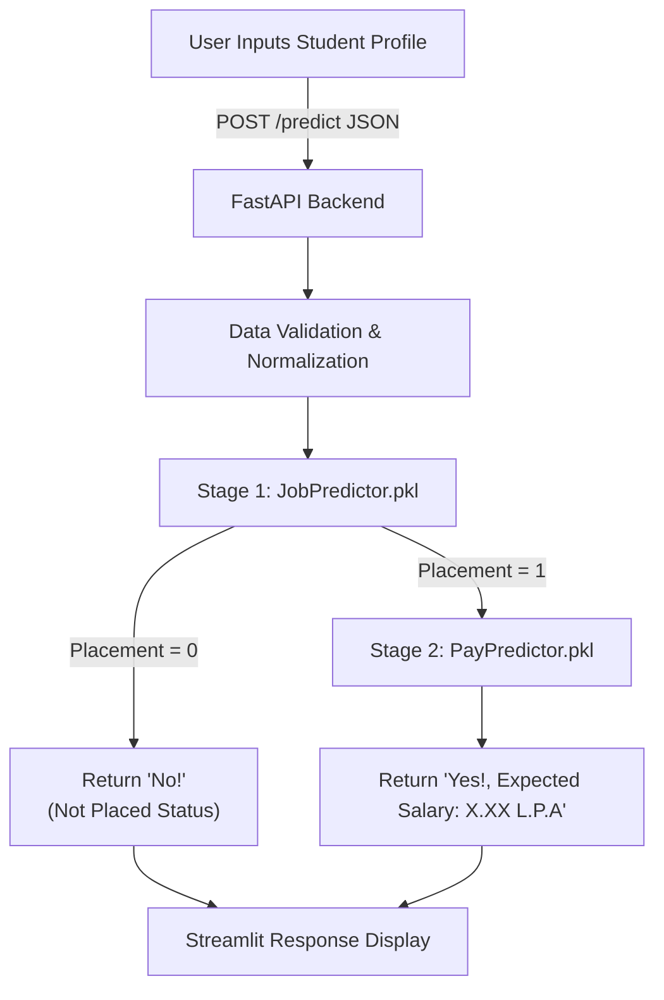

# 🎓 Student Placement Model: Placement & Salary Predictor

Student Placement Model is an end-to-end machine learning system: a synthetic dataset of 100,000 engineering student records, two-stage ensemble architecture using **StackingClassifier** and **StackingRegressor**, served via a **FastAPI** backend and an interactive **Streamlit** web app.

|    Dataset Size     |     Classification Task      |      Regression Task      |               Tech Stack               |
| :-----------------: | :--------------------------: | :-----------------------: | :------------------------------------: |
| **100,000 Records** | **Placement Status (0 / 1)** | **Expected Salary (LPA)** | **FastAPI + Streamlit + Scikit-Learn** |

---

## 🎯 What does it do?

Campus placements are critical for engineering students. This application answers two crucial questions based on 16 student parameters (academics, technical skills, and practical experience):

1. **Will the student get placed?**
2. **If placed, what is the expected annual salary package?**

**You provide:** Academic details (branch, college tier, CGPA, backlogs), technical skills (coding, DSA, aptitude, system design, ML), and hands-on experience (internships, projects, hackathons, open source).  
**You get:** Instant verdict card and predicted package.

> Example output: **PLACED!** _(Expected Salary: 18.45 L.P.A)_

---

## 🏗 How it works (architecture)

The system utilizes a **two-stage prediction pipeline** separated into microservices:



### 🧠 Model Architecture & Ensembles

Both models are saved as full **Scikit-Learn Pipelines** incorporating automated preprocessing:

1. **Classification Pipeline (`JobPredictor.pkl`)**:
   - **Performance**: Accuracy: **69.95%** | Precision: **71.90%** | Recall: **92.11%** | F1-Score: **80.76%**
   - **Preprocessing**: `OrdinalEncoder` for college tier (`Tier-1`, `Tier-2`, `Tier-3`), `OneHotEncoder` for engineering branch, and `StandardScaler` for all numeric features.
   - **Base Estimators**: Logistic Regression ($C=0.01$), K-Nearest Neighbors ($k=18$, distance-weighted), Random Forest (900 estimators, max depth 8).
   - **Meta-Estimator**: Logistic Regression with 5-fold cross-validation stacking.

2. **Regression Pipeline (`PayPredictor.pkl`)**:
   - **Performance**: $R^2$ Score: **78.23%** | M.A.P.E.: **5.75%**
   - **Preprocessing**: Matching ordinal & one-hot transformations + standard scaling.
   - **Base Estimators**: Ridge Regression ($\alpha=10$), K-Nearest Neighbors Regressor ($k=13$), Random Forest Regressor (400 estimators, max depth 18).
   - **Meta-Estimator**: Linear Regression with 5-fold cross-validation stacking.

---

## 📦 The dataset

| Attribute                  | Details                                                                |
| :------------------------- | :--------------------------------------------------------------------- |
| **Source file**            | `data/student_placement_synthetic.csv`                                 |
| **Total records**          | 100,000 student records × 18 columns                                   |
| **Placement distribution** | Placed: **68.5%** \| Not Placed: **31.5%**                             |
| **Salary range**           | 6.88 LPA — 28.33 LPA                                                   |
| **Inputs**                 | 16 features (academic metrics, scores, project & experience counts)    |
| **Targets**                | `placement_status` (Classification), `salary_package_lpa` (Regression) |

---

## 📁 Project structure

```
Student_Placement_Model/
├── backend/
│   └── main.py                     # FastAPI application
├── frontend/
│   └── app.py                      # Streamlit UI
├── schema/
│   └── student_info.py             # Pydantic schema validation
├── model/
│   ├── JobPredictor.pkl            # Trained StackingClassifier pipeline
│   ├── PayPredictor.pkl            # Trained StackingRegressor pipeline (Hugging Face)
│   ├── model_prediction.py         # Two-stage model inference logic
│   └── download_models.py          # Script to fetch PayPredictor.pkl from Hugging Face
├── model_training/
│   ├── classification_model.py     # Training script for placement classification
│   └── regression_model.py         # Training script for salary regression
├── data/
│   └── student_placement_synthetic.csv   # Synthetic placement dataset
├── .dockerignore                   # Files excluded from Docker build context
├── Dockerfile                      # Container image definition (FastAPI + Streamlit)
├── start.sh                        # Entrypoint script launching backend & frontend
├── requirements.txt                # Python dependencies
└── README.md
```

---

## 🚀 Run it locally

### 1. Clone and install dependencies

```bash
git clone https://github.com/Yash-Codezz/Student.Placement.Model.git
cd Student_Placement_Model
pip install -r requirements.txt
```

### 2. Download large model artifacts (if needed)

The regression model (`PayPredictor.pkl`) is hosted on Hugging Face Hub:

```bash
python model/download_models.py
```

### 3. Start the FastAPI backend

Run the backend API server on port 8000:

```bash
uvicorn backend.main:app --reload
```

Interactive Swagger documentation will be available at: `http://127.0.0.1:8000/docs`

### 4. Launch the Streamlit frontend

In a separate terminal, launch the web application:

```bash
streamlit run Frontend/app.py
```

Then navigate to `http://localhost:8501` in your browser.

### Or run with Docker

Build and run both the FastAPI backend and Streamlit frontend in a single container:

```bash
docker build -t student-placement-model .
docker run -p 8000:8000 -p 8501:8501 student-placement-model
```

- FastAPI Swagger docs: `http://127.0.0.1:8000/docs`
- Streamlit UI: `http://localhost:8501`

---

## 🛠 Tech stack

| Purpose                  | Tools                                                                            |
| :----------------------- | :------------------------------------------------------------------------------- |
| **Language**             | Python 3.10+                                                                     |
| **Data & Preprocessing** | Pandas, NumPy                                                                    |
| **Machine Learning**     | Scikit-Learn (Ensemble Stacking, Random Forest, Ridge, KNN, Logistic Regression) |
| **Model Hosting**        | Hugging Face Hub                                                                 |
| **Backend API**          | FastAPI, Uvicorn, Pydantic                                                       |
| **Frontend UI**          | Streamlit                                                                        |
| **Model Serialization**  | Joblib                                                                           |
| **Containerization**     | Docker                                                                           |

---

<p align="center">Built by <b>Yash</b> · If you found this useful consider giving the repo a ⭐</p>
